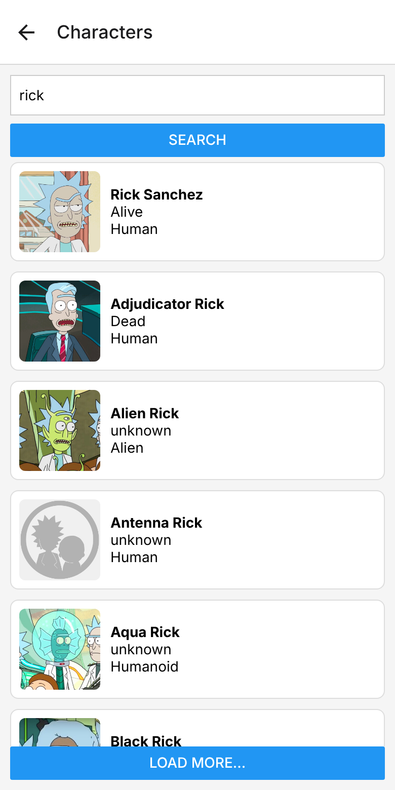
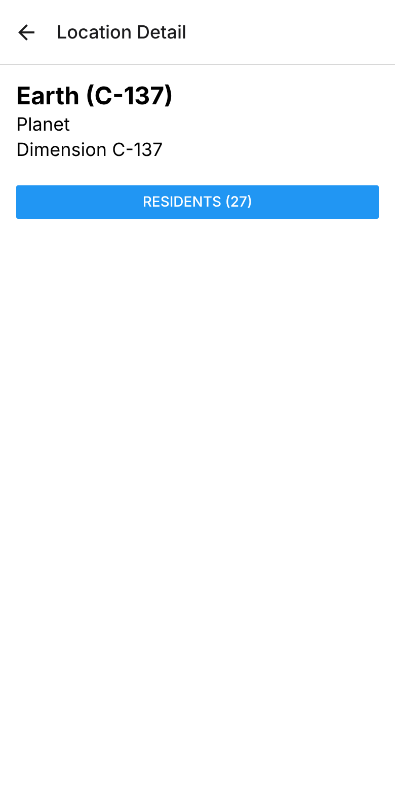
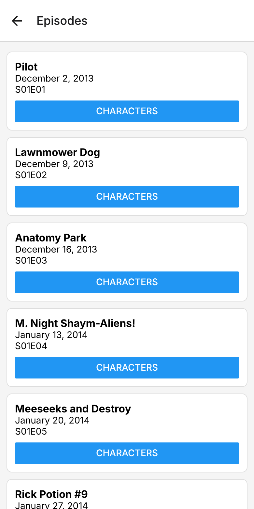

# Rick and Morty Guide

App mobile em React Native (Expo) que consome a [Rick and Morty API](https://rickandmortyapi.com/): busca de personagens, detalhes do personagem, locais com seus residentes e episódios com seu elenco.

Projeto desenvolvido na disciplina de Desenvolvimento Mobile (Engenharia de Computação — IF Goiano, Campus Trindade), a partir da aula [08 — Consumindo uma API REST](https://github.com/rgomide/react-native-web-lessons/tree/main/08-consuming-a-rest-api).

| Busca | Personagem | Local | Episódios |
| --- | --- | --- | --- |
|  |  |  |  |

## Funcionalidades

- Busca de personagens por nome com paginação ("Load More")
- Detalhe do personagem com navegação para origem, localização e episódios
- Detalhe do local com a lista de residentes
- Lista de episódios com o elenco de cada um
- Indicador de carregamento e mensagens de erro
- Telas didáticas sobre o ciclo de vida do `useEffect` e a proteção contra condição de corrida

## Tecnologias

- React Native 0.86 + Expo SDK 57 (React 19)
- React Navigation (native stack)
- API `fetch` com timeout via `AbortController`
- Hooks `useState` e `useEffect`

## Como rodar

Pré-requisito: [Node.js](https://nodejs.org/) LTS.

```bash
git clone https://github.com/stelv29/rick-and-morty-guide.git
cd rick-and-morty-guide
npm install
npm run web
```

O app abre no navegador em `http://localhost:8081`.

## Estrutura

```
src/
  api/rick-and-morty.js       # todas as requisições HTTP
  components/CharacterCard.js # card reutilizável de personagem
  screens/                    # uma pasta por tela
```

## Autora

Stéphany Lima Vital — [github.com/stelv29](https://github.com/stelv29)
